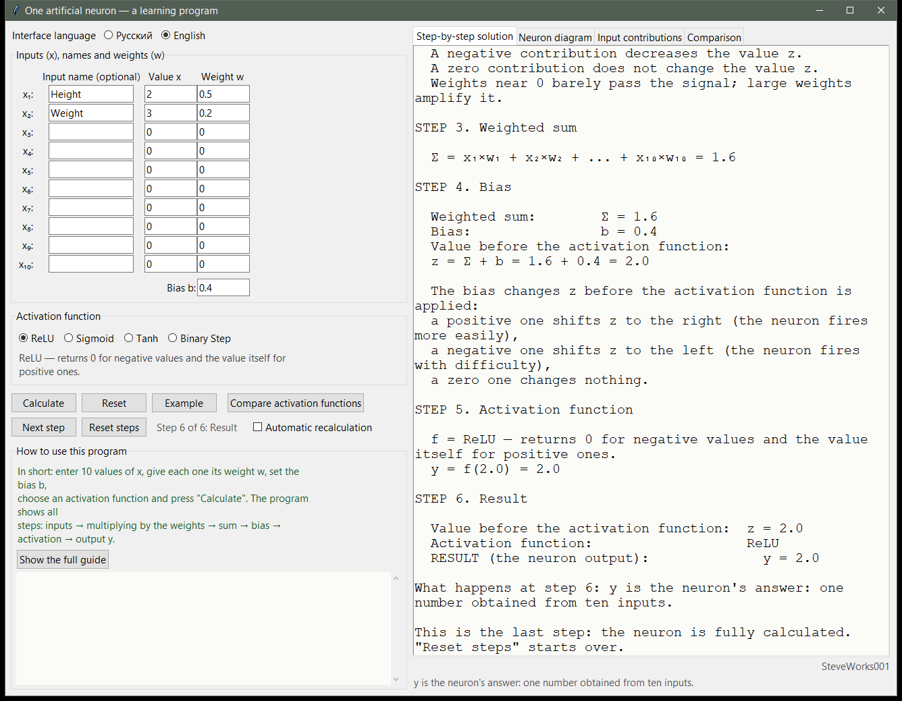
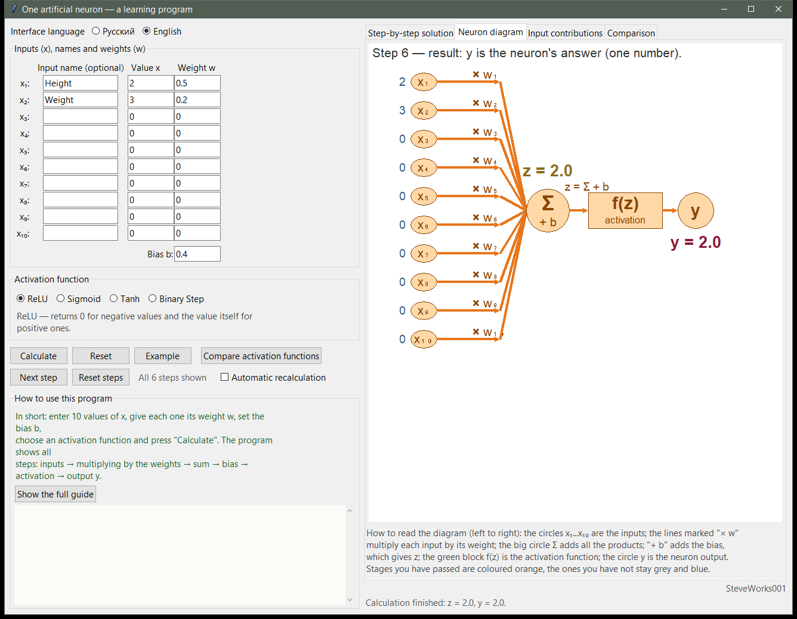
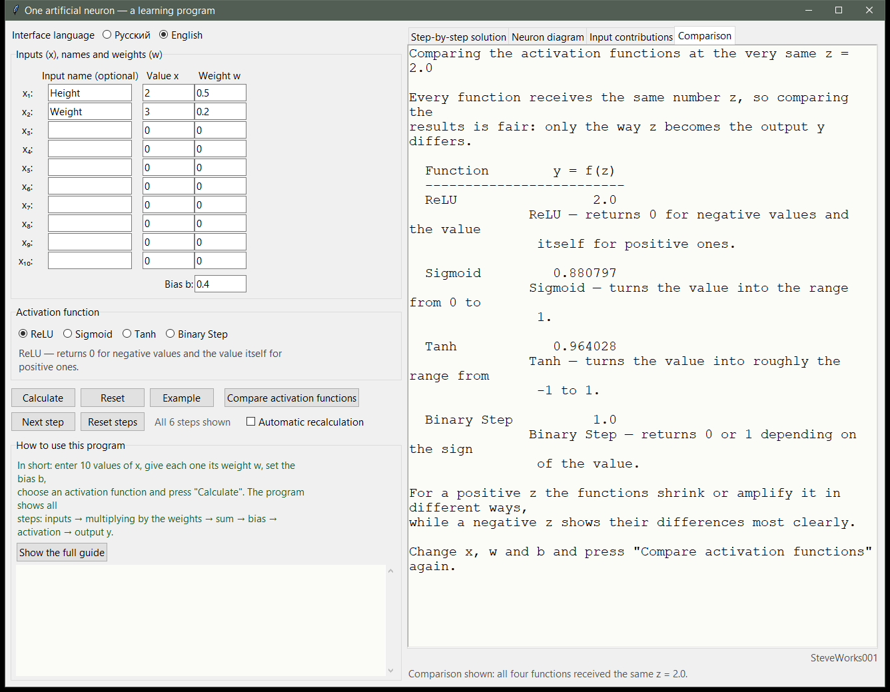

# One Artificial Neuron — an Educational Simulator

Project 1 of 13 in the educational neural-network simulator series.
A single-file Python and Tkinter application: standard library only, no external
packages, no network and no dependency installation.
It shows the **internal computation of a single artificial neuron** step by step, from ten
inputs down to one number at the output. Here a neuron is not a "black box": you can see
the product of each input with its weight, the weighted sum, the addition of the bias, the
activation function being applied, and the final answer.

---

## Purpose

A neuron usually meets a beginner as one formula, and the explanation ends there. In this
simulator you enter your own numbers and follow the whole chain of reasoning: how much each
input added to the sum, where exactly the bias appeared, and how the chosen activation
function turns `z` into `y`.

The application trains nothing and optimizes nothing. It is a visual calculator for one
neuron with a detailed explanation of every step — meant for a first encounter with how
artificial neural networks are built.

### What this project does not contain

- no training: the weights are set only by you, by hand;
- no backpropagation, no gradients, no optimizer;
- no classification, no training examples, no error counting;
- no layers and no networks — exactly **one** neuron is modelled;
- no datasets, files, quality metrics, saving or loading of results.

---

## Learning goals

- Understand that a neuron's answer is the sum of input-times-weight products plus a bias.
- See each input's contribution separately and understand how a weight amplifies an input,
  switches it off, or flips it to the negative side.
- Understand the role of the bias as a shift applied to `z` before the activation function.
- Understand why an activation function is needed, and tell the four functions apart by
  formula, output range and behavior.
- Understand the difference between `z` — the value before activation — and `y` — the value
  after it.
- Walk through the whole computation across the six stages with concrete numbers.
- Realize that one neuron is a few multiplications and additions, which is enough as a
  starting point before layers and training.

---

## Mathematics: how the neuron is computed

The main formula:

```text
pᵢ = xᵢ × wᵢ        Σ = p₁ + p₂ + ... + p₁₀
z = Σ + b           y = f(z)
```

The computation chain: **inputs and weights → products → weighted sum `Σ` → `z = Σ + b` →
activation function `f` → output `y`**.

Terms you will meet in the interface:

- **Inputs `x₁ ... x₁₀`** — the numbers the neuron receives: its information about the
  world. The number of inputs is fixed at 10.
- **Weights `w₁ ... w₁₀`** — the "importance" factor of each input: how strongly it affects
  the answer.
- **Contribution `pᵢ = xᵢ × wᵢ`** — how much this particular input added to the result.
- **Weighted sum `Σ`** — the sum of all contributions.
- **Bias `b`** — a number added to the sum, shifting the result before the activation
  function is applied.
- **`z`** — the value "before" the activation function.
- **Activation function `f`** — turns `z` into the neuron's output; without it a neuron
  would be nothing but addition.
- **Output `y`** — the final answer of the neuron, a single number.

### The six stages

| Stage | What happens | Notation |
| --- | --- | --- |
| 1 | The neuron receives ten numbers | `x₁ ... x₁₀` |
| 2 | Each input is multiplied by its own weight | `x₁ × w₁ ... x₁₀ × w₁₀` |
| 3 | All products are added together | `Σ` |
| 4 | The bias is added to the sum | `z = Σ + b` |
| 5 | The chosen activation function is applied | `f(z)` |
| 6 | One number is obtained — the neuron's answer | `y` |

### Activation functions

An activation function is needed to obtain the neuron's output `y` from the value `z` and to
give it the required shape: limit its range, zero out negative values, or turn it into a
"yes / no".

| Function | How it is computed | Range of `y` | What it does |
| --- | --- | --- | --- |
| **ReLU** | `max(0, z)` | `[0, +∞)` | Turns negative values into 0 and leaves positive ones untouched. The most common activation function in the early layers of networks. |
| **Sigmoid** | `1 / (1 + e⁻ᶻ)` | `(0, 1)` | Compresses any number into a smooth "sigmoid" answer between 0 and 1 — convenient when a probabilistic output is needed. |
| **Tanh** | `tanh(z)` | `(-1, 1)` | Like Sigmoid, but centred around zero: negative values give a negative output. |
| **Binary Step** | `1` if `z ≥ 0`, else `0` | `{0, 1}` | A hard switch: the neuron fired or it did not. Historically the activation function of the very first perceptron. |

Function names are not translated in the interface.

### The built-in example

The **"Example"** button fills in verified numbers:

```text
x₁ = 2,  w₁ = 0.5
x₂ = 3,  w₂ = 0.2
x₃ ... x₁₀ = 0   (their weights are 0 as well)
b = 0.4
activation function: ReLU
```

Stage by stage:

```text
contributions: x₁ × w₁ = 2 × 0.5 = 1.0,  x₂ × w₂ = 3 × 0.2 = 0.6, the rest = 0
sum:           Σ = 1.0 + 0.6 = 1.6
bias:          z = Σ + b = 1.6 + 0.4 = 2.0
activation:    y = ReLU(2.0) = 2.0
```

For the very same `z = 2.0` the other functions would give Sigmoid → `0.880797`,
Tanh → `0.964028`, Binary Step → `1.0`.

What is worth feeling here: a weight of `0` "disconnects" an input, a weight of `2` doubles
its contribution, and a negative weight flips the contribution and lowers `z`. The bias
works like an excitation threshold: a positive `b` raises `z`, a negative one lowers it, a
zero one changes nothing.

### How numbers are displayed

- Inputs, weights and products are printed compactly: `2`, `-3`, `0.6`.
- Stage results always carry a decimal point: `1.6`, `2.0`.
- Contributions carry a sign, so a zero contribution does not look empty: `+1.0`, `-6.0`,
  `+0.0`.

---

## Interface and usage

- **The data panel** — ten inputs `x₁ ... x₁₀`, ten weights, a bias field `b`, and a choice
  of one of the four activation functions. An input can be given its own name (the "Input
  name" column): it is then labelled `Height (x₁)` instead of `x₁`. Names affect labels
  only, never the arithmetic.
- **Calculation buttons**: "Calculate" shows all six stages at once, "Example" fills in the
  verified numbers and computes, "Reset" returns the form to its initial state.
- **Step-by-step mode** — the "Next step" and "Reset steps" buttons and a counter such as
  `Step 3 of 6: Summing`: each press appends the next stage together with its explanation.
  Fields can be changed at any moment, and the next step already uses the new values.
  "Reset steps" returns the counter to zero and clears the numbers on the diagram; after
  stage 6 there are no new stages.
- **Four tabs**: "Step-by-step solution", "Neuron diagram", "Input contributions",
  "Comparison".
- **The neuron diagram** is a graphical data path that reads from left to right: input
  circles `x₁ ... x₁₀`, "× wᵢ" lines, the large `Σ` circle, "+ b", the `f(z)` block, the `y`
  circle. The stage you have reached turns orange, while the rest keep their own base colors:
  grey lines, blue input circles, a yellow `Σ`, a green `f(z)` block and a pink output circle.
  The value of each input appears to the left of its circle, `z = ...` above `Σ`, and
  `y = ...` below the output circle. The highlighting updates both from "Calculate" and
  from "Next step".
- **Input contributions** — one line per input, `xᵢ × wᵢ = contribution`, plus a text bar:
  to the right the contribution is positive and raises `z`, to the left it is negative and
  lowers `z`, an empty bar means the input affects nothing, a short bar means its weight is
  close to zero. Bar lengths are scaled relative to the largest contribution by absolute
  value, so "who is stronger" is obvious at a glance. `Σ` and `z = Σ + b` are printed at the
  bottom. A useful exercise: change one weight from `0.5` to `-0.5` — the bar flips to the
  left and `z` becomes smaller.
- **Automatic recalculation** — a checkbox (off by default): when enabled, any change to an
  input `x`, a weight, an input name, the bias `b` or the chosen function immediately
  recomputes the neuron and redraws the diagram, with no button pressed. "Calculate" works in
  both states.
- **Number input**: integers and decimals are accepted, including negative values (`2`,
  `-1.5`, `0.25`); a comma as the decimal separator is understood too (`0,5` → `0.5`); an
  empty field counts as zero. Invalid input never crashes the app: instead of a solution you
  get a clear message that names the field at fault.
- **The status bar** explains the current action. The "How to use this program" box holds a
  short sequence of steps, and the "Show the full guide" button expands the complete
  14-section guide in a scrollable area.

The interface is available in Russian and English and switches on the fly, without a
restart; everything visible is translated, including the text the program generates while
computing. Russian is the default, and the numbers you typed, the input names and the chosen
function are preserved when the language changes.

---

## Screenshots

All three shots use the program's built-in example: `x₁ = 2, w₁ = 0.5`, `x₂ = 3, w₂ = 0.2`,
`b = 0.4`, activation function ReLU. For these values `Σ = 1.6`, `z = Σ + b = 2.0`, `y = 2.0`.

**Step-by-step solution** — the six stages in one scrollable panel: the weighted sum `Σ`,
the bias, `z = Σ + b` and the final output `y`, with the counter `Step 6 of 6: Result` above
the text.



**Neuron diagram** — the data path from left to right: input circles with their numbers,
"× w" lines, the `Σ` circle with "+ b", the `f(z)` block and the output `y = 2.0`; the stages
already passed are highlighted in orange.



**Activation-function comparison** — all four functions receive the very same `z = 2.0` and
return different outputs: ReLU `2.0`, Sigmoid `0.880797`, Tanh `0.964028`, Binary Step `1.0`.



---

## Comparing activation functions

The **"Compare activation functions"** button opens the **"Comparison"** tab: all four
functions receive **the very same number `z`**, so the comparison is fair — only the way `z`
is turned into the output `y` differs. Each row is followed by a short note on what that
function does.

Change `x`, `w` and `b` and press the button again — the result is recomputed for the current
`z`. Comparing the numbers shows that for a positive `z` the functions compress or amplify
the value differently, while for a negative `z` the differences are felt most strongly: ReLU
and Binary Step return zero, Sigmoid moves closer to zero, Tanh toward `-1`.

---

## Guided experiments

Every experiment uses only controls that exist in the window; nothing has to be
installed and no external file is needed.

**1. A negative weight.** Change `w₁` from `0.5` to `-0.5` and press "Calculate".
Observe: on the contributions tab the line `x₁ × w₁ = ...` flips sign, its text bar
points left, and both `Σ` and `z` shrink. Think about: why `Σ` drops by exactly
`x₁ × 1.0` rather than `x₁ × 0.5`, and which value of `w₁` makes this input stop
contributing at all.

**2. All inputs at zero.** Set all ten `xᵢ` to `0` and leave the weights alone. Then
`Σ = 0` for any weights, so `z` equals the bias alone: moving `b` moves `z` directly.
Compare the four answers at `b = 0`: ReLU gives `0.0`, Sigmoid `0.5`, Tanh `0.0`,
Binary Step `1.0`. Think about: why one and the same `z = 0` produces four different outputs,
and which of those outputs follows from a convention about the boundary case rather
than from the data.

**3. One `z`, four functions.** Press "Example": you get `Σ = 1.6` and `z = 2.0`.
Without touching anything else, switch the activation function: ReLU — `2.0`, Sigmoid
— `0.880797`, Tanh — `0.964028`, Binary Step — `1.0`. Now set `b = -3.6`, so that
`z = -2.0`: ReLU — exactly `0.0`, Sigmoid — `0.119203`, Tanh — `-0.964028`, Binary
Step — `0.0`. Think about: which function loses the size of a negative `z` completely, which
one only compresses it smoothly, and how the dead branch of ReLU differs from
saturation of the sigmoid.

**4. The order of stages.** Press "Reset steps" and walk to `Step 6 of 6` with
"Next step". Observe at which stage the number `Σ` first appears, at which one `z`
appears, and when `y` finally shows up. Think about: why `z` cannot be known before
all ten products are computed, and what the bias stage adds to the summation stage.

---

## Installation and launch

The application is a single file; no build step and no dependency installation are required.

Windows:

```bash
python neuron.py
```

or, if several Python versions are installed:

```bash
py neuron.py
```

macOS and Linux:

```bash
python3 neuron.py
```

A 1320×1000 window opens. Quick start: press **"Example"** — the program fills in the
verified numbers and immediately shows `Σ = 1.6`, `z = 2.0`, `y = 2.0`.

The language switch is at the top of the data panel: **Русский** / **English**.

---

## Requirements

- Python 3.8 or newer.
- Tkinter — included in the official Python builds for Windows and macOS; on some Linux
  distributions it is installed separately as the `python3-tk` package.
- Standard library only: `math`, `textwrap`, `tkinter`, `tkinter.ttk`, `tkinter.font`.
- Not used: NumPy, pandas, SciPy, matplotlib, TensorFlow, PyTorch, Keras, scikit-learn and
  third-party GUI frameworks.
- No network connection is required to run the application.

The application is intended for a typical desktop display: the window opens at 1320×1000 and
cannot be shrunk much below 1240×820.

---

## Limitations

- This is an **educational simulator**, not a production ML framework: the neuron is not
  trained, and the weights are set by hand.
- Exactly **one** neuron is modelled — no layers, no multi-layer architectures.
- **The number of inputs is fixed** at 10; changing it requires editing the code.
- Gradients, backpropagation and an optimizer are not implemented anywhere.
- No data loading, CSV files, labelling, batches or quality metrics.
- No saving or loading: results are not written to files and not exported.
- GUI only: there is no console mode, API or batch run, and a working Tkinter is required to
  launch it.
- Two interface languages: Russian and English.

---

## Educational note

The simulator exists to make the mechanism of one artificial neuron understandable — without
gradient theory and without frameworks. Some conventions are chosen for clarity and may
differ from the conventions used by a particular machine-learning library: for instance,
Binary Step returns `1` at `z = 0`, and the number of inputs is hard-wired to 10. Before
using a neuron in a real model, check the definitions in your library.

---

## What to know beforehand

**Hard requirements:** Python 3 with the Tkinter module and the ability to run a file
from a command line. The application has no dependencies, no build step, no network
use and no external files.

**Mathematics:** multiplying and adding ordinary numbers, negatives included, and
reading notation such as `pᵢ = xᵢ · wᵢ`. Derivatives, gradients, matrices and
probability are not needed — none of them appear in this project.

**Earlier projects are not required:** this is the first project of the series and it
explains everything from scratch.

About the Python version: the Requirements section names Python 3.8 or newer, but the
application never checks the version and no other version has been run — treat that
as declared compatibility, not a verified guarantee.

---

## Place in the series

Project 1 of 13. The order is not strict: every project runs on its own and reads
nothing from its neighbours. Only connections that exist by subject are listed below.

| Project | What it adds to this one |
|---|---|
| 2 — Perceptron | the same neuron as a two-class classifier: a decision boundary over a plane of points, plus a training rule that changes the weights after mistakes |
| 3 — Mini Neural Network | several neurons arranged in layers (2 inputs → 3 hidden →1 output): a forward pass through a row of neurons |
| 7 — Activation Functions | the same activation functions examined on their own, thistime together with their derivatives |
| 5 and 6 — Backpropagation, Neural Network Training | derivatives and training appearthere; here they are deliberately absent |

The pair built here, `z = Σ + b` and `y = f(z)`, is the pair that keeps reappearing in
every later project of the series.

---

## Developer

**Developer: SteveWorks001**
