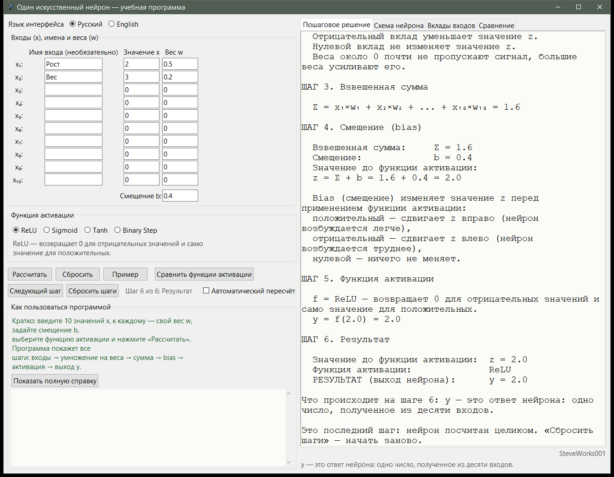
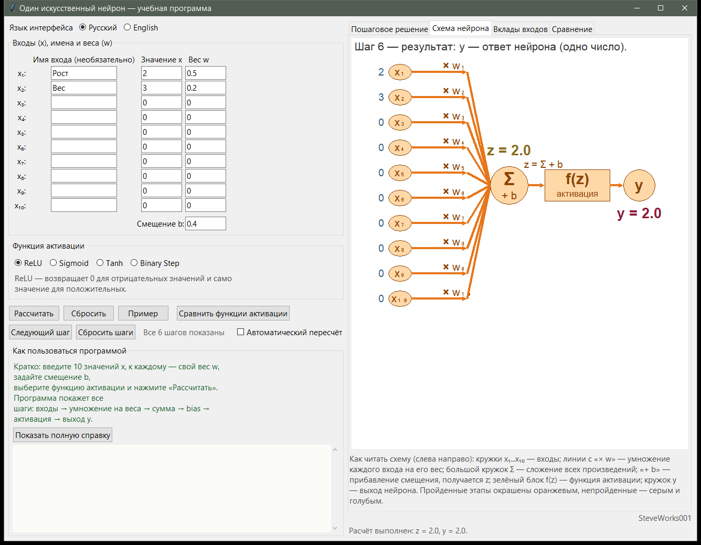
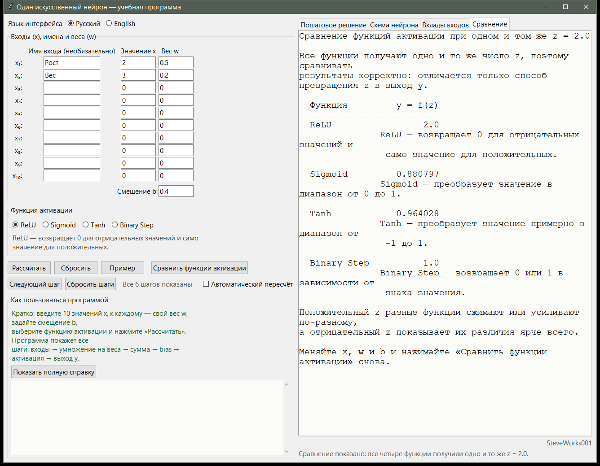

# Один искусственный нейрон — учебный симулятор

Проект 1 из 13 серии учебных симуляторов нейронных сетей.
Однофайловое приложение на Python и Tkinter: только стандартная библиотека,
без внешних пакетов, без сети и без установки зависимостей.
Программа показывает **внутренние вычисления одного искусственного нейрона** по шагам:
от десяти входов до одного числа на выходе. Нейрон здесь — не «чёрный ящик»: видно
произведение каждого входа на его вес, взвешенную сумму, прибавление смещения,
применение функции активации и итоговый ответ.

---

## Назначение

Обычно нейрон встречает новичка одной формулой, и на этом объяснение заканчивается.
В этом симуляторе можно ввести свои числа и увидеть всю цепочку рассуждений: сколько
каждый вход добавил к сумме, где именно появился bias, как выбранная функция активации
превращает `z` в `y`.

Приложение ничего не обучает и ничего не оптимизирует. Это наглядный калькулятор одного
нейрона с подробным пояснением каждого шага — для первого знакомства с тем, как устроены
искусственные нейронные сети.

### Чего в этом проекте нет

- нет обучения: веса задаёте только вы, вручную;
- нет обратного распространения ошибки, градиентов и оптимизатора;
- нет классификации, обучающих примеров и подсчёта ошибок;
- нет слоёв и сетей — моделируется ровно **один** нейрон;
- нет датасетов, файлов, метрик качества и сохранения результатов.

---

## Учебные цели

- Понять, что ответ нейрона — это сумма произведений входов на веса плюс смещение.
- Видеть вклад каждого входа отдельно и понимать, как вес усиливает вход, обнуляет его
  или разворачивает в отрицательную сторону.
- Понять роль смещения (bias) как сдвига значения `z` до применения функции активации.
- Понять, зачем нужна функция активации, и различать четыре функции по формуле,
  диапазону результата и поведению.
- Понять разницу между `z` — значением до активации и `y` — значением после неё.
- Пройти всю цепочку вычисления по шести этапам на конкретных числах.
- Осознать, что один нейрон — это несколько умножений и сложений: этого достаточно как
  отправной точки перед слоями и обучением.

---

## Математика: как считается нейрон

Основная формула:

```text
pᵢ = xᵢ × wᵢ        Σ = p₁ + p₂ + ... + p₁₀
z = Σ + b           y = f(z)
```

Цепочка вычисления: **входы и веса → произведения → взвешенная сумма `Σ` → `z = Σ + b` →
функция активации `f` → выход `y`**.

Понятия, которые встретятся в интерфейсе:

- **Входы `x₁ ... x₁₀`** — числа, которые нейрон получает «на вход»: его информация
  о мире. Количество входов фиксировано и равно 10.
- **Веса `w₁ ... w₁₀`** — коэффициент «важности» каждого входа: насколько сильно он
  влияет на ответ.
- **Вклад `pᵢ = xᵢ × wᵢ`** — сколько именно этот вход добавил к общему результату.
- **Взвешенная сумма `Σ`** — сумма всех вкладов.
- **Смещение `b` (bias)** — число, которое прибавляется к сумме и сдвигает результат до
  применения функции активации.
- **`z`** — значение «до» функции активации.
- **Функция активации `f`** — превращает `z` в выход нейрона; без неё нейрон был бы
  просто сложением чисел.
- **Выход `y`** — итоговый ответ нейрона, одно число.

### Шесть этапов

| Этап | Что происходит | Обозначение |
| --- | --- | --- |
| 1 | Нейрон получает десять чисел | `x₁ ... x₁₀` |
| 2 | Каждый вход умножается на свой вес | `x₁ × w₁ ... x₁₀ × w₁₀` |
| 3 | Все произведения складываются | `Σ` |
| 4 | К сумме прибавляется смещение | `z = Σ + b` |
| 5 | Применяется выбранная функция активации | `f(z)` |
| 6 | Получается одно число — ответ нейрона | `y` |

### Функции активации

Функция активации нужна, чтобы из значения `z` получить выход нейрона `y` и придать ему
нужную форму: ограничить диапазон, обнулить отрицательные значения или превратить в
«да / нет».

| Функция | Как считается | Диапазон `y` | Что делает |
| --- | --- | --- | --- |
| **ReLU** | `max(0, z)` | `[0, +∞)` | Отрицательные значения превращает в 0, положительные оставляет как есть. Самая частая функция активации в первых слоях сетей. |
| **Sigmoid** | `1 / (1 + e⁻ᶻ)` | `(0, 1)` | Сжимает любое число в плавный «сигмоидный» ответ от 0 до 1 — удобно, когда нужен вероятностный выход. |
| **Tanh** | `tanh(z)` | `(-1, 1)` | Как Sigmoid, но с центром около нуля: отрицательные значения дают отрицательный выход. |
| **Binary Step** | `1`, если `z ≥ 0`, иначе `0` | `{0, 1}` | Жёсткий переключатель: сработал нейрон или нет. Исторически — функция активации самого первого перцептрона. |

Названия функций активации в интерфейсе не переводятся.

### Учебный пример

Кнопка **«Пример»** подставляет проверенные числа:

```text
x₁ = 2,  w₁ = 0.5
x₂ = 3,  w₂ = 0.2
x₃ ... x₁₀ = 0   (веса у них тоже 0)
b = 0.4
функция активации: ReLU
```

По этапам:

```text
вклады:    x₁ × w₁ = 2 × 0.5 = 1.0,  x₂ × w₂ = 3 × 0.2 = 0.6, остальные = 0
сумма:     Σ = 1.0 + 0.6 = 1.6
смещение:  z = Σ + b = 1.6 + 0.4 = 2.0
активация: y = ReLU(2.0) = 2.0
```

Для того же `z = 2.0` другие функции дали бы Sigmoid → `0.880797`, Tanh → `0.964028`,
Binary Step → `1.0`.

Что здесь важно почувствовать: вес `0` «отключает» вход, вес `2` удваивает его вклад,
а отрицательный вес разворачивает вклад в обратную сторону и уменьшает `z`. Смещение
работает как порог возбуждения: положительный `b` увеличивает `z`, отрицательный
уменьшает, нулевой не меняет ничего.

### Как показываются числа

- Входы, веса и произведения печатаются компактно: `2`, `-3`, `0.6`.
- Результаты этапов — всегда с десятичной точкой: `1.6`, `2.0`.
- Вклады — со знаком, чтобы вклад нуля не выглядел «пустым»: `+1.0`, `-6.0`, `+0.0`.

---

## Интерфейс и как пользоваться

- **Панель данных** — десять входов `x₁ ... x₁₀`, десять весов, поле смещения `b` и выбор
  одной из четырёх функций активации. У входа можно задать своё имя (столбец «Имя входа»):
  тогда он подписывается как `Рост (x₁)` вместо `x₁`. На арифметику имена не влияют.
- **Кнопки расчёта**: «Рассчитать» показывает все шесть этапов сразу, «Пример» заполняет
  проверенные числа и считает, «Сбросить» возвращает форму в исходное состояние.
- **Пошаговый режим** — кнопки «Следующий шаг» и «Сбросить шаги» и счётчик вида
  `Шаг 3 из 6: Суммирование`: каждое нажатие добавляет новый этап и пояснение к нему.
  Поля можно менять в любой момент — следующий шаг уже использует новые значения.
  «Сбросить шаги» обнуляет счётчик и очищает числа на схеме; после шестого шага новых
  этапов нет.
- **Четыре вкладки**: «Пошаговое решение», «Схема нейрона», «Вклады входов», «Сравнение».
- **Схема нейрона** — графический путь данных, который читается слева направо: кружки
  входов `x₁ ... x₁₀`, линии «× wᵢ», большой кружок `Σ`, «+ b», блок `f(z)`, кружок `y`.
  Пройденный этап подсвечивается оранжевым, остальные остаются в своих базовых цветах:
  линии серые, кружки входов голубые, `Σ` жёлтый, блок `f(z)` зелёный, выход розовый.
  Слева от кружка входа появляется его число, над `Σ` — `z = ...`, под кружком выхода —
  `y = ...`. Подсветка обновляется и кнопкой «Рассчитать», и кнопкой «Следующий шаг».
- **Вклады входов** — на каждый вход строка `xᵢ × wᵢ = вклад` и текстовая полоска:
  вправо — вклад положительный и увеличивает `z`, влево — отрицательный и уменьшает,
  пустая полоска — вход ни на что не влияет, короткая — вес близок к нулю. Длины
  полосок масштабируются относительно самого большого по модулю вклада, поэтому сравнение
  «кто сильнее» видно сразу. Внизу приведены `Σ` и `z = Σ + b`. Полезное упражнение:
  поменяйте один вес с `0.5` на `-0.5` — полоска развернётся влево, а `z` уменьшится.
- **Автопересчёт** — флажок (по умолчанию выключен): при включении любое изменение входа,
  веса, имени входа, смещения `b` или выбранной функции сразу пересчитывает нейрон и
  перерисовывает схему, без нажатия кнопок. Кнопка «Рассчитать» работает при обоих
  состояниях флажка.
- **Ввод чисел**: принимаются целые и дробные значения, в том числе отрицательные
  (`2`, `-1.5`, `0.25`); запятая как десятичный разделитель тоже понимается
  (`0,5` → `0.5`); пустое поле считается нулём. Некорректный ввод не роняет приложение:
  вместо решения появляется понятное сообщение, в котором названо проблемное поле.
- **Строка состояния** поясняет текущее действие. Блок «Как пользоваться программой»
  содержит краткий порядок действий, а кнопка «Показать полную справку» раскрывает полную
  справку из 14 разделов в прокручиваемой области.

Интерфейс доступен на русском и английском и переключается на ходу, без перезапуска;
переводится всё видимое, включая тексты, которые программа генерирует по ходу расчёта.
Русский установлен по умолчанию, а введённые числа, имена и выбранная функция при смене
языка сохраняются.

---

## Скриншоты

Все три снимка сделаны на встроенном учебном примере программы: `x₁ = 2, w₁ = 0.5`,
`x₂ = 3, w₂ = 0.2`, `b = 0.4`, функция активации ReLU. Для них `Σ = 1.6`,
`z = Σ + b = 2.0`, `y = 2.0`.

**Пошаговое решение** — шесть этапов в прокручиваемой панели: взвешенная сумма `Σ`,
смещение, `z = Σ + b` и итоговый выход `y`; над текстом виден счётчик
`Шаг 6 из 6: Результат`.



**Схема нейрона** — путь данных слева направо: кружки входов со своими числами, линии
«× w», кружок `Σ` с «+ b», блок `f(z)` и выход `y = 2.0`; пройденные этапы подсвечены
оранжевым.



**Сравнение функций активации** — все четыре функции получают одно и то же `z = 2.0`
и дают разные выходы: ReLU `2.0`, Sigmoid `0.880797`, Tanh `0.964028`, Binary Step `1.0`.



---

## Сравнение функций активации

Кнопка **«Сравнить функции активации»** открывает вкладку **«Сравнение»**: все четыре
функции получают **одно и то же число `z`**, поэтому сравнение корректно — отличается
только способ превращения `z` в выход `y`. После каждой строки приведено короткое
пояснение, что делает эта функция.

Меняйте `x`, `w` и `b` и нажимайте кнопку снова — результат пересчитывается для текущего
`z`. Сравнивая числа, видно, что при положительном `z` функции сжимают или усиливают
значение по-разному, а при отрицательном `z` различия ощущаются всего сильнее: ReLU и
Binary Step дают ноль, Sigmoid уходит ближе к нулю, Tanh — к `-1`.

---

## Учебные опыты

Каждый опыт делается кнопками самого приложения; ни внешних файлов, ни установки
ничего не требуется.

**1. Отрицательный вес.** Измените `w₁` с `0.5` на `-0.5` и нажмите «Рассчитать».
Наблюдайте: на вкладке «Вклады входов» строка `x₁ × w₁ = ...` меняет знак, текстовая
полоска уходит влево, `Σ` и `z` уменьшаются. О чём подумать: почему `Σ` изменился ровно
на `x₁ × 1.0`, а не на `x₁ × 0.5`, — и при каком значении `w₁` вклад входа перестаёт
влиять на ответ.

**2. Нулевые входы.** Обнулите все десять `xᵢ`, оставив веса как есть. Тогда `Σ = 0` при
любых весах, и `z` равен одному лишь `b`: меняя `b`, вы сдвигаете `z` напрямую.
Сравните ответы четырёх функций при `b = 0`: ReLU — `0.0`, Sigmoid — `0.5`, Tanh —
`0.0`, Binary Step — `1.0`. О чём подумать: почему одно и то же `z = 0` даёт четыре разных
ответа и какой из этих ответов — следствие договорённости о согласующем правиле, а не
свойство самих данных.

**3. Один `z` — четыре функции.** Нажмите «Пример»: получится `Σ = 1.6` и `z = 2.0`.
Ничего больше не трогая, переключайте функцию активации: ReLU — `2.0`, Sigmoid —
`0.880797`, Tanh — `0.964028`, Binary Step — `1.0`. Затем поставьте `b = -3.6`, чтобы
получить `z = -2.0`: ReLU — ровно `0.0`, Sigmoid — `0.119203`, Tanh — `-0.964028`,
Binary Step — `0.0`. О чём подумать: какая функция полностью теряет величину
отрицательного `z`, какая лишь плавно её сжимает, и чем «мёртвая» ветвь ReLU
отличается от насыщения сигмоиды.

**4. Порядок этапов.** Нажмите «Сбросить шаги» и дойдите кнопкой «Следующий шаг» до
`Шаг 6 из 6`. Наблюдайте, на каком этапе впервые появляется число `Σ`, на каком — `z`
и когда появляется `y`. О чём подумать: почему `z` нельзя узнать раньше, чем посчитаны
все десять произведений, и что именно добавляет этап смещения к этапу суммирования.

---

## Установка и запуск

Приложение — один файл; сборки и установки зависимостей не требуется.

Windows:

```bash
python neuron.py
```

или, если в системе несколько версий Python:

```bash
py neuron.py
```

macOS и Linux:

```bash
python3 neuron.py
```

Откроется окно 1320×1000. Быстрый старт: нажмите **«Пример»** — программа заполнит
проверенные числа и сразу покажет `Σ = 1.6`, `z = 2.0`, `y = 2.0`.

Переключатель языка — вверху левой панели: **Русский** / **English**.

---

## Требования

- Python 3.8 или новее.
- Tkinter — входит в официальные сборки Python для Windows и macOS; в некоторых
  дистрибутивах Linux ставится отдельно как пакет `python3-tk`.
- Только стандартная библиотека: `math`, `textwrap`, `tkinter`, `tkinter.ttk`,
  `tkinter.font`.
- Не используются: NumPy, pandas, SciPy, matplotlib, TensorFlow, PyTorch, Keras,
  scikit-learn и сторонние GUI-фреймворки.
- Сетевое соединение для работы приложения не требуется.

Приложение рассчитано на типичный десктопный дисплей: окно открывается размером
1320×1000 и не уменьшается примерно ниже 1240×820.

---

## Ограничения

- Это **учебный симулятор**, а не производственный ML-фреймворк: нейрон не обучается,
  веса задаются вручную.
- Моделируется ровно **один** нейрон — без слоёв и многослойных архитектур.
- **Количество входов фиксировано** — 10; изменить его можно только правкой кода.
- Градиенты, обратное распространение ошибки и оптимизатор не реализованы нигде.
- Нет загрузки данных, файлов CSV, разметки, батчей и метрик качества.
- Нет сохранения и загрузки: результаты не пишутся в файлы и не экспортируются.
- Только графический интерфейс: нет консольного режима, API или пакетного запуска,
  для запуска нужен доступный Tkinter.
- Два языка интерфейса: русский и английский.

---

## Учебная оговорка

Симулятор предназначен для понимания механизма одного искусственного нейрона — без теории
градиентов и без фреймворков. Отдельные соглашения выбраны ради наглядности и могут
отличаться от соглашений, принятых в конкретной библиотеке машинного обучения: например,
Binary Step здесь даёт `1` при `z = 0`, а количество входов жёстко равно 10. Перед
использованием в реальной модели сверяйтесь с определениями вашей библиотеки.

---

## Что нужно знать заранее

**Строго необходимо:** Python 3 с модулем Tkinter и возможность запустить файл из
командной строки. Зависимостей, сборки, сети и внешних файлов у приложения нет.

**Математика:** умножение и сложение обычных чисел, включая отрицательные, и чтение
записей вида `pᵢ = xᵢ · wᵢ`. Производные, градиенты, матрицы и вероятность здесь не
нужны — их в этом проекте нет.

**Прошлые проекты не обязательны:** это первый проект серии, и он объясняет всё с
нуля.

О версии Python: раздел «Требования» называет Python 3.8 или новее, но приложение версию
не проверяет, а запуск на других версиях не тестировался — это объявленная
совместимость, а не проверенная гарантия.

---

## Место в серии

Проект 1 из 13. Порядок не строгий: каждый проект запускается сам по себе и ничего не
читает из соседних. Ниже только те связи, которые есть по содержанию.

| Проект | Что он добавляет к этому |
|---|---|
| 2 — Перцептрон | тот же нейрон как классификатор двух классов: граница решения на
плоскости точек и правило обучения, которое меняет веса после ошибок |
| 3 — Мини-нейросеть | несколько нейронов, собранных в слои (2 входа → 3 скрытых →
1 выход): прямой проход через ряд нейронов подряд |
| 7 — Activation Functions | те же функции активации разбираются отдельно и вместе с
производными |
| 5 и 6 — Backpropagation, Neural Network Training | там появляются производная и
обучение; здесь их нет намеренно |

Дальше по серии везде работает пара этого проекта: `z = Σ + b` и ответ функции
активации `y = f(z)`.

---

## Разработчик

**Разработчик: SteveWorks001**
